# CA2 — Kubernetes PaaS Orchestration on Amazon EKS

## CS5287 Cloud Computing

CA2 migrates the authentication-event processing pipeline developed in CA0/CA1 to a Kubernetes-based PaaS architecture running on **Amazon Elastic Kubernetes Service (EKS)**.

The logical application pipeline remains:

**Producer → Kafka → Processor → MongoDB**

The Processor also exposes a REST API for application health and event access.

This project demonstrates:

- Amazon EKS
- Kubernetes Deployments and StatefulSets
- Docker and Amazon ECR
- AWS EBS persistent storage
- Kubernetes ConfigMaps and Secrets
- NetworkPolicy isolation
- Least-privilege RBAC
- Metrics Server
- Horizontal Pod Autoscaling
- Horizontal scaling and throughput measurement
- Automated deployment and destruction
- End-to-end pipeline validation
- Reproducible application deployment

---

# 1. System Architecture

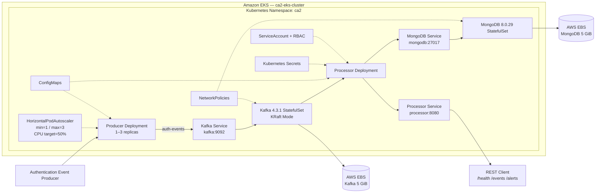

## Event Flow

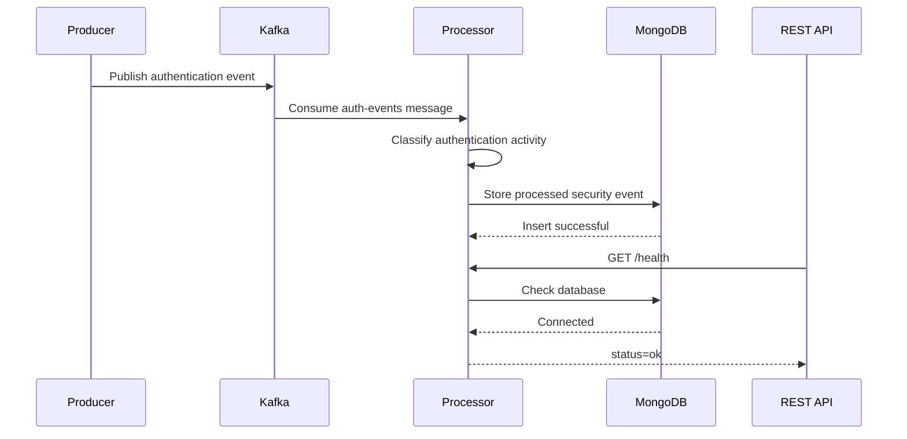

---

# 2. Project Structure

```text
CA2/
├── README.md
├── IntegrityPacket.md
├── Makefile
│
├── base/
│   └── namespace.yaml
│
├── eks/
│   └── cluster.yaml
│
├── kafka/
│   ├── service.yaml
│   └── statefulset.yaml
│
├── mongodb/
│   ├── secret.template.yaml
│   ├── service.yaml
│   ├── statefulset.yaml
│   └── storageclass.yaml
│
├── processor/
│   ├── Dockerfile
│   ├── configmap.yaml
│   ├── deployment.yaml
│   ├── processor.py
│   ├── requirements.txt
│   ├── secret.template.yaml
│   └── service.yaml
│
├── producer/
│   ├── Dockerfile
│   ├── configmap.yaml
│   ├── deployment.yaml
│   ├── producer.py
│   └── requirements.txt
│
├── network/
│   └── network-policy.yaml
│
├── rbac/
│   └── processor-rbac.yaml
│
├── scaling/
│   └── producer-hpa.yaml
│
├── scripts/
│   ├── create-secrets.sh
│   ├── evidence.sh
│   ├── scaling-test.sh
│   ├── setup-cluster.sh
│   └── smoke-test.sh
│
└── evidence/
    ├── 01-ca2-eks-iam-permissions.png
    ├── 02-eks-three-nodes.png
    ├── 03-mongodb-statefulset-pvc.png
    ├── 04-kafka-mongodb-statefulsets-pvcs.png
    ├── 05-processor-rest-health.png
    ├── 06-end-to-end-pipeline.png
    ├── 07-network-policy-enforcement.png
    ├── 08-rbac-least-privilege.png
    ├── 09-producer-scaling-throughput.png
    ├── 10-hpa-autoscaling.png
    ├── 11-full-kubernetes-stack.png
    ├── 12-kafka-persistent-storage.png
    ├── 13-brute-force-processing.png
    ├── 14-automated-redeployment.png
    └── 15-post-redeploy-pipeline-validation.png
```

---

# 3. Prerequisites

Before deploying CA2, the following tools and access are required:

- AWS CLI configured with the `ca2` profile
- `eksctl`
- `kubectl`
- Docker Desktop / Docker Engine
- Docker Buildx
- GNU Make
- Python 3
- `envsubst` from GNU gettext
- Access to the AWS account used for Amazon EKS and Amazon ECR
- Permission to pull the private Producer and Processor images from Amazon ECR
- A valid Kubernetes context after the EKS cluster is created

Important versions used during CA2:

| Component | Version |
|---|---|
| Amazon EKS / Kubernetes | 1.34 |
| Apache Kafka | 4.3.1 |
| MongoDB | 8.0.29 |
| Python container base | 3.12 |

Check local tool versions with:

```bash
aws --version
eksctl version
kubectl version --client
docker --version
```

After creating the cluster, verify the Kubernetes context:

```bash
kubectl config current-context
kubectl get nodes
```

The EBS CSI Pod Identity IAM prerequisite described later in this README must also be available before EBS volumes can be dynamically provisioned.

---

# 4. Kubernetes Platform

The application runs on an Amazon EKS cluster.

| Setting | Value |
|---|---|
| Cluster | `ca2-eks-cluster` |
| AWS Region | `us-east-2` |
| Worker nodes | 3 |
| Node group | `ca2-workers` |
| Instance type | `t3.small` |
| Kubernetes namespace | `ca2` |

The cluster definition is stored in:

[`eks/cluster.yaml`](eks/cluster.yaml)

Create the cluster with:

```bash
make -C CA2 cluster-up
```

Configure the cluster platform with:

```bash
make -C CA2 cluster-setup
```

The platform setup handles the supported EKS add-on configuration, including the Pod Identity Agent, EBS CSI add-on, and VPC CNI NetworkPolicy configuration.

## Cluster Evidence

Three EKS worker nodes were successfully created and reached the `Ready` state.

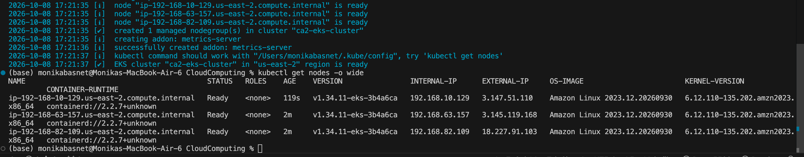

The cluster was validated using:

```bash
kubectl get nodes -o wide
```

---

# 5. Container Images and Amazon ECR

The Producer and Processor applications are packaged as Docker images.

The development machine uses Apple Silicon while the EKS worker nodes use AMD64, so the custom application images were explicitly built for:

```text
linux/amd64
```

Example:

```bash
docker buildx build \
  --platform linux/amd64 \
  -t ca2-producer:v2 \
  --load \
  CA2/producer
```

Private Amazon ECR repositories are used for:

```text
ca2-producer
ca2-processor
```

The Kubernetes Deployment manifests reference the private ECR images and their required image tags.

No AWS credentials are stored in this README.

---

# 6. Producer

The Producer continuously generates authentication events.

Each event contains fields including:

```text
event_id
username
source_ip
success
timestamp
```

The Producer publishes events to:

```text
Kafka broker: kafka:9092
Kafka topic:  auth-events
```

Configuration is stored in:

[`producer/configmap.yaml`](producer/configmap.yaml)

The Producer runs as a Kubernetes Deployment:

[`producer/deployment.yaml`](producer/deployment.yaml)

This allows multiple replicas and horizontal scaling.

The final Producer manifest also contains a `wait-for-kafka` init container. This prevents the application container from starting until `kafka:9092` is reachable.

This Producer init-container refinement was added after the live EKS environment had been torn down. Its YAML and script integration were statically validated, but it was not part of the earlier live-cluster screenshots.

---

# 7. Kafka

Apache Kafka **4.3.1** runs as a Kubernetes StatefulSet in **KRaft mode**, so ZooKeeper is not required.

| Setting | Value |
|---|---|
| Client port | `9092` |
| Controller port | `9093` |
| Topic | `auth-events` |
| Kubernetes Service | `kafka` |
| Replicas | 1 |
| Storage | 5 GiB EBS |

Kafka is defined in:

- [`kafka/statefulset.yaml`](kafka/statefulset.yaml)
- [`kafka/service.yaml`](kafka/service.yaml)

Applications access Kafka through:

```text
kafka:9092
```

---

# 8. Kafka Persistent Storage

Kafka uses an AWS EBS-backed PersistentVolumeClaim.

Kafka stores its data under:

```text
/var/lib/kafka/data/kafka
```

A dedicated `kafka` subdirectory is used instead of the filesystem root so that the EBS `lost+found` directory is not interpreted as Kafka topic data.

The mounted volume was inspected from inside the Kafka Pod and contained Kafka metadata and consumer-offset directories.

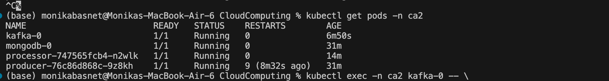

This demonstrates that Kafka was actively writing to persistent EBS storage rather than temporary container storage.

---

# 9. MongoDB

MongoDB **8.0.29** runs as a Kubernetes StatefulSet.

| Setting | Value |
|---|---|
| Service | `mongodb` |
| Port | `27017` |
| Database | `threat_monitor` |
| Collection | `security_events` |
| Storage | 5 GiB EBS |

MongoDB configuration is stored in:

- [`mongodb/statefulset.yaml`](mongodb/statefulset.yaml)
- [`mongodb/service.yaml`](mongodb/service.yaml)
- [`mongodb/storageclass.yaml`](mongodb/storageclass.yaml)

MongoDB stores database files under:

```text
/data/db
```

---

# 10. Persistent Storage Evidence

MongoDB was successfully deployed with a Bound PersistentVolumeClaim.

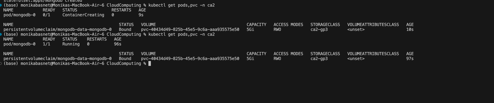

Kafka and MongoDB were also verified together with both PVCs in the `Bound` state.

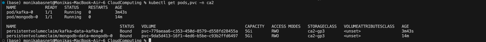

---

# 11. AWS EBS CSI Driver

Persistent storage is dynamically provisioned through the AWS EBS CSI driver:

```text
ebs.csi.aws.com
```

The custom StorageClass is:

```text
ca2-gp3
```

Its configuration includes:

```text
EBS type:          gp3
Encryption:        enabled
Volume expansion:  enabled
Binding mode:      WaitForFirstConsumer
```

## EBS CSI Pod Identity

The EBS CSI controller uses EKS Pod Identity.

ServiceAccount:

```text
kube-system/ebs-csi-controller-sa
```

IAM role name:

```text
eksctl-ca2-ebs-csi-role
```

The role uses the AWS-managed EBS CSI policy required for EBS operations.

Creation of the IAM role requires elevated IAM permissions. Therefore, this association is documented as a cluster-level prerequisite rather than an application-level Kubernetes resource.

The remaining supported cluster setup is automated through:

```bash
make -C CA2 cluster-setup
```

---

# 12. Configuration Management

Non-sensitive application settings are stored in Kubernetes ConfigMaps.

Processor configuration includes:

```text
KAFKA_BROKER
KAFKA_TOPIC
MONGODB_DATABASE
MONGODB_COLLECTION
API_PORT
```

Producer configuration includes:

```text
KAFKA_BROKER
KAFKA_TOPIC
PRODUCE_INTERVAL
```

This keeps environment-specific configuration separate from container images.

---

# 13. Secrets Management

Sensitive MongoDB credentials are **not committed to GitHub**.

Declarative Secret templates are provided:

- [`mongodb/secret.template.yaml`](mongodb/secret.template.yaml)
- [`processor/secret.template.yaml`](processor/secret.template.yaml)

The script:

[`scripts/create-secrets.sh`](scripts/create-secrets.sh)

prompts securely for the MongoDB password during deployment.

The template files contain placeholders rather than real credentials.

At deployment time, `envsubst` renders the runtime values into Kubernetes Secret resources, which are applied with `kubectl`.

The script creates:

```text
mongodb-secret
processor-secret
```

MongoDB credentials are URL-encoded before the Processor connection URI is generated. This supports passwords containing URL-sensitive characters.

The repository was scanned for common AWS credential and password patterns before submission.

The final scan returned no matching real credentials.

The Secret-template refinement was added after the live cluster had been torn down. The templates and shell script were statically validated but were not rerun against the deleted EKS environment.

---

# 14. Processor

The Processor consumes authentication events from Kafka.

Its responsibilities are:

1. Consume events from `auth-events`.
2. Track authentication failures.
3. Classify suspicious login activity.
4. Store processed events in MongoDB.
5. Expose a REST API.

The Processor runs as a Kubernetes Deployment:

[`processor/deployment.yaml`](processor/deployment.yaml)

---

# 15. Reliable Processor Startup

During testing, the Processor could start before Kafka was ready and encounter:

```text
NoBrokersAvailable
```

The Processor Deployment was revised to contain a `wait-for-kafka` init container.

The init container checks:

```text
kafka:9092
```

and does not allow the main Processor container to start until Kafka is reachable.

This Processor startup fix was validated during the final live destroy/redeploy test.

---

# 16. REST API

The Processor exposes a REST API on port:

```text
8080
```

The Service is defined in:

[`processor/service.yaml`](processor/service.yaml)

For local validation:

```bash
kubectl port-forward -n ca2 service/processor 8080:8080
```

Then, from another terminal:

```bash
curl http://localhost:8080/health
```

A successful response is:

```json
{"kafka_topic":"auth-events","mongodb":"connected","status":"ok"}
```

## REST Evidence

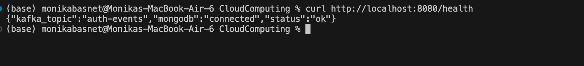

This demonstrates that the Processor REST API was available and MongoDB connectivity was healthy.

---

# 17. End-to-End Pipeline

The complete event flow is:

```text
Producer
   ↓
Kafka auth-events
   ↓
Processor
   ↓
MongoDB
```

The Producer successfully published authentication events.

The Processor consumed and classified the events.

MongoDB stored the processed results.

## Evidence

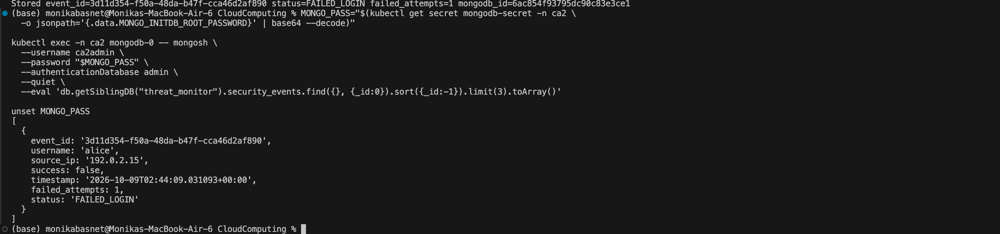

This validates the required logical pipeline:

```text
Producers → pub/sub hub → Processor → DB/Analytics
```

---

# 18. Brute-Force Detection

Repeated failed authentication events increase the failed-attempt counter.

Once suspicious activity is detected, the Processor classifies events as:

```text
POSSIBLE_BRUTE_FORCE
```

The Processor then stores the events in MongoDB.

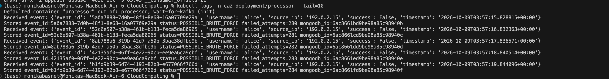

The logs demonstrate both classification and successful database persistence.

---

# 19. Network Isolation

Network security is implemented using Kubernetes NetworkPolicy.

Configuration:

[`network/network-policy.yaml`](network/network-policy.yaml)

## Kafka

Kafka allows TCP `9092` traffic from the required workloads:

```text
Producer
Processor
```

## MongoDB

MongoDB allows TCP `27017` traffic from:

```text
Processor
```

Unauthorized Pods are not permitted to directly access these protected services through the defined ingress policies.

Amazon VPC CNI NetworkPolicy enforcement was enabled.

## Validation

An unauthorized test Pod attempted to connect to MongoDB and received:

```text
Connection timed out
```

The authorized Processor was then tested and returned:

```text
Processor -> MongoDB: ALLOWED
```

## Evidence

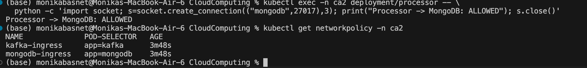

This demonstrates:

```text
Unauthorized path → blocked
Authorized path   → allowed
```

---

# 20. RBAC and Least Privilege

Kubernetes RBAC is defined in:

[`rbac/processor-rbac.yaml`](rbac/processor-rbac.yaml)

The Processor uses:

```text
ServiceAccount: processor-sa
```

The namespace Role provides limited ConfigMap read access.

The ServiceAccount does not receive unnecessary destructive privileges.

## Allowed Test

```bash
kubectl auth can-i get configmaps \
  --as=system:serviceaccount:ca2:processor-sa \
  -n ca2
```

Result:

```text
yes
```

## Denied Test

```bash
kubectl auth can-i delete pods \
  --as=system:serviceaccount:ca2:processor-sa \
  -n ca2
```

Result:

```text
no
```

## Evidence

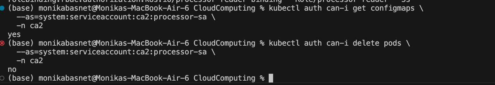

---

# 21. Observability

Kubernetes Metrics Server provides CPU and memory metrics.

Metrics were validated with:

```bash
kubectl top pods -n ca2
```

CPU and memory measurements were available for:

- Kafka
- MongoDB
- Processor
- Producer

These metrics are also available to the Horizontal Pod Autoscaler.

---

# 22. Horizontal Scaling Experiment

The Producer was tested using identical 30-second measurement windows.

## Baseline — One Producer

```text
31 events / 30 seconds
≈ 1.03 events/second
```

## Scaled — Three Producers

```text
98 events / 30 seconds
≈ 3.27 events/second
```

## Comparison

| Producer Replicas | Events / 30 sec | Events/sec |
|---:|---:|---:|
| 1 | 31 | 1.03 |
| 3 | 98 | 3.27 |

Observed improvement:

```text
≈ 3.16x
```

## Evidence

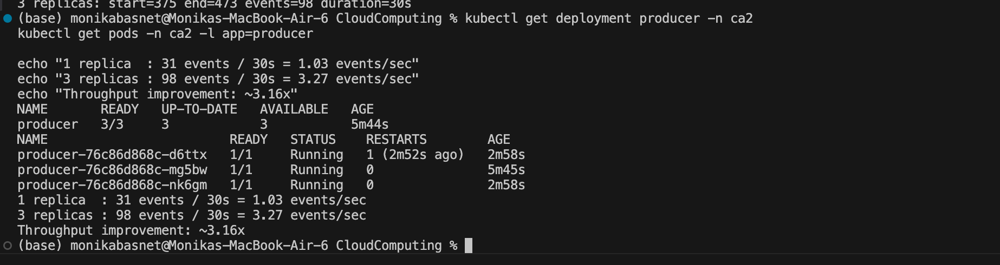

The experiment demonstrates increased event throughput when additional Producer replicas are deployed.

A repeatable version of this procedure is provided by:

```bash
make -C CA2 scaling-test
```

---

# 23. Horizontal Pod Autoscaler

The Producer HPA is defined in:

[`scaling/producer-hpa.yaml`](scaling/producer-hpa.yaml)

Configuration:

| Setting | Value |
|---|---:|
| Minimum replicas | 1 |
| Maximum replicas | 3 |
| CPU target | 50% |

During testing, Producer CPU utilization was approximately 4%.

After the Producer had previously been scaled to three replicas, the HPA automatically reduced the Deployment back to one replica.

## Evidence

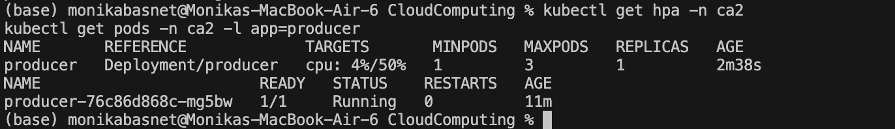

This demonstrates automatic CPU-based **scale-down**.

A sustained CPU-load experiment forcing automatic HPA scale-up was not performed, and this limitation is documented rather than overstated.

---

# 24. Complete Kubernetes Stack

The final live Kubernetes environment contained:

```text
Kafka StatefulSet
MongoDB StatefulSet
Processor Deployment
Producer Deployment
Kafka Service
MongoDB Service
Processor Service
Kafka PVC
MongoDB PVC
ConfigMaps
Secrets
NetworkPolicies
RBAC
HorizontalPodAutoscaler
```

## Evidence

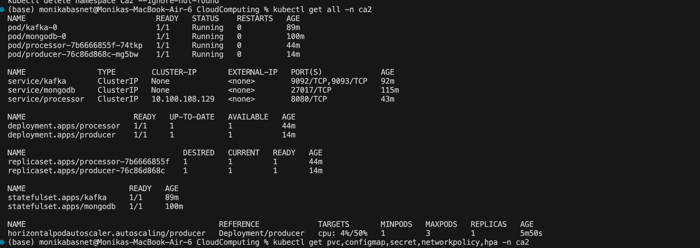

---

# 25. Automated Deployment

The project includes a Makefile for repeatable operation.

## Create EKS

```bash
make -C CA2 cluster-up
```

## Configure Cluster Platform

```bash
make -C CA2 cluster-setup
```

## Deploy Application

```bash
make -C CA2 deploy
```

The deployment workflow:

1. Creates the `ca2` namespace.
2. Prompts securely for the MongoDB password.
3. Renders and applies Kubernetes Secrets.
4. Creates the StorageClass.
5. Deploys MongoDB.
6. Deploys Kafka.
7. Deploys the Processor.
8. Deploys the Producer.
9. Applies NetworkPolicies.
10. Applies RBAC.
11. Creates the Producer HPA.

## Check Status

```bash
make -C CA2 status
```

## Delete Application

```bash
make -C CA2 destroy
```

---

# 26. Fresh Environment Workflow

A fresh environment follows this order:

```text
1. Create EKS cluster
        ↓
2. Configure required EBS CSI Pod Identity prerequisite
        ↓
3. Configure cluster platform add-ons
        ↓
4. Deploy application
        ↓
5. Validate workloads
```

Create the cluster:

```bash
make -C CA2 cluster-up
```

Complete the documented EBS CSI Pod Identity prerequisite when required.

Then configure the cluster platform:

```bash
make -C CA2 cluster-setup
```

Deploy the application:

```bash
make -C CA2 deploy
```

This separation between cluster infrastructure, privileged IAM prerequisites, cluster add-ons, and application resources is intentional.

---

# 27. Smoke Test

CA2 provides a repeatable smoke-test target:

```bash
make -C CA2 smoke-test
```

The smoke-test workflow checks:

1. Application Pods and PVCs.
2. Kafka topics.
3. Producer output.
4. Processor output.
5. MongoDB record count.
6. REST endpoint test instructions.

For the REST portion, run in Terminal 1:

```bash
kubectl port-forward -n ca2 service/processor 8080:8080
```

Then in Terminal 2:

```bash
curl http://localhost:8080/health
```

Expected response:

```json
{"kafka_topic":"auth-events","mongodb":"connected","status":"ok"}
```

The original live smoke-test evidence was collected manually before this helper script was added.

---

# 28. Reproducible Scaling Test

Run:

```bash
make -C CA2 scaling-test
```

The scaling test:

1. Scales the Producer to one replica.
2. Waits for the Deployment.
3. Measures MongoDB event growth over 30 seconds.
4. Scales the Producer to three replicas.
5. Waits for the Deployment.
6. Measures another 30-second interval.
7. Reports events and calculated events per second.

The validated live experiment produced:

| Producer Replicas | Events / 30 sec | Approx. Events/sec |
|---:|---:|---:|
| 1 | 31 | 1.03 |
| 3 | 98 | 3.27 |

Observed throughput improvement:

**approximately 3.16x**

Evidence:

[Scaling throughput evidence](evidence/09-producer-scaling-throughput.png)

The helper script reproduces the measurement procedure used during the live experiment, but the script itself was added after cluster teardown and therefore received static rather than live validation.

---

# 29. Evidence Collection

Run:

```bash
make -C CA2 evidence
```

The evidence helper collects:

- `kubectl get all -A`
- CA2 PersistentVolumeClaims
- NetworkPolicies
- RBAC resources
- HPA status
- Pod CPU and memory metrics

This provides a repeatable evidence-collection procedure for future deployments.

The helper was added after the original live evidence had already been captured.

---

# 30. Logs and Results

Producer logs:

```bash
kubectl logs -n ca2 deployment/producer -c producer --tail=20
```

Processor logs:

```bash
kubectl logs -n ca2 deployment/processor -c processor --tail=20
```

Kafka logs:

```bash
kubectl logs -n ca2 kafka-0 --tail=20
```

MongoDB logs:

```bash
kubectl logs -n ca2 mongodb-0 --tail=20
```

Resource metrics:

```bash
kubectl top pods -n ca2
```

HPA status:

```bash
kubectl get hpa -n ca2
```

Persistent storage:

```bash
kubectl get pvc -n ca2
```

Captured screenshots and validated results are stored in:

[`evidence/`](evidence/)

Engineering claims and supporting evidence are mapped in:

[**IntegrityPacket.md**](IntegrityPacket.md)

---

# 31. Destroy and Redeploy Validation

Reproducibility was tested by deleting the complete CA2 application:

```bash
make -C CA2 destroy
```

The `ca2` namespace was verified as absent.

The application was then recreated using:

```bash
make -C CA2 deploy
```

After deployment:

```text
Kafka       1/1 Running
MongoDB     1/1 Running
Processor   1/1 Running
Producer    1/1 Running

Kafka PVC   Bound
MongoDB PVC Bound
```

No manual Processor restart was required during the final validation.

## Evidence

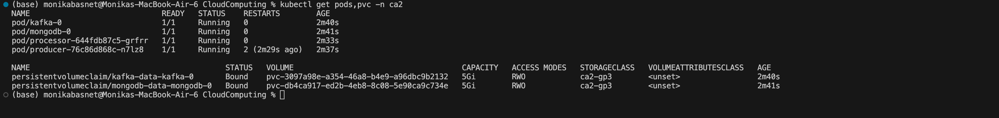

---

# 32. Post-Redeployment Pipeline Validation

After automated redeployment, the Processor resumed consuming authentication events and storing them in MongoDB.

Processor logs showed repeated:

```text
Received event
Stored event_id=...
```

## Evidence

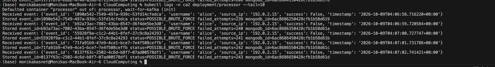

This demonstrates that the application was not only recreated successfully but also returned to functional end-to-end operation.

---

# 33. IAM / Platform Setup Evidence

AWS IAM permissions were configured to support the EKS deployment and required AWS services.

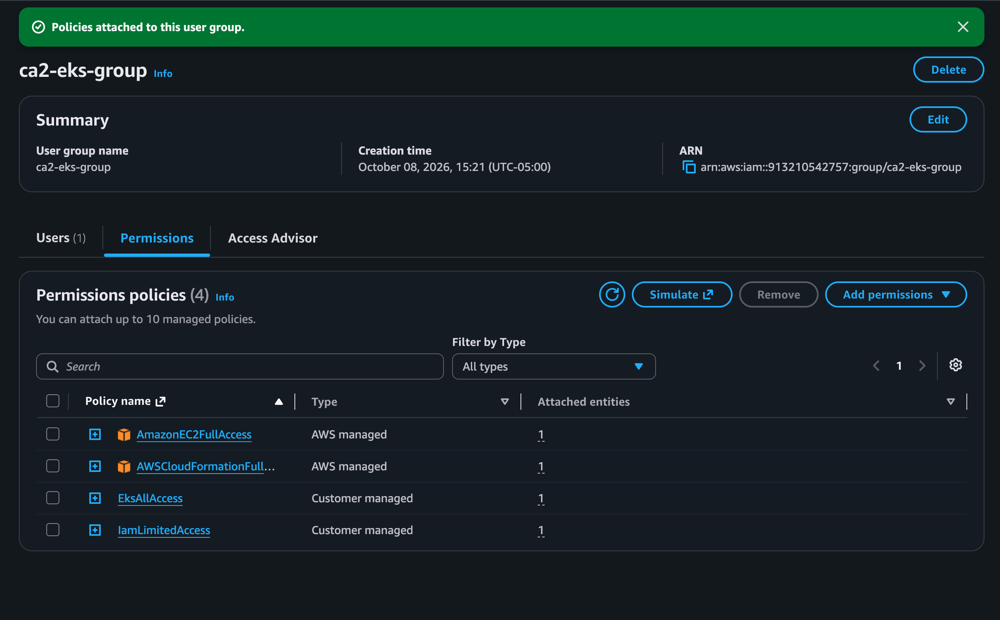

IAM role creation for EBS CSI Pod Identity required elevated AWS permissions and is documented as a cluster-level prerequisite.

No AWS credentials are committed to this repository.

---

# 34. Security Controls

CA2 implements multiple security layers:

| Control | Implementation |
|---|---|
| Secret management | Declarative Secret templates + runtime values |
| Git credential hygiene | Real passwords/keys excluded |
| Network isolation | Kubernetes NetworkPolicy |
| NetworkPolicy enforcement | Amazon VPC CNI |
| Authorization | Kubernetes RBAC |
| Workload identity | Dedicated Processor ServiceAccount |
| Persistent volume encryption | Encrypted gp3 EBS |
| AWS workload permissions | EKS Pod Identity |
| Private images | Amazon ECR |
| MongoDB authentication | Enabled |
| Published application exposure | ClusterIP only |

---

# 35. Deviations from CA0/CA1

CA2 preserves the original logical application pipeline:

```text
Producer → Kafka → Processor → MongoDB
```

The deployment model was changed to satisfy Kubernetes orchestration requirements.

## Producer

The CA0 Producer operated as a one-shot workload. For CA2, it was adapted to run continuously as a Kubernetes Deployment.

This enables:

- multiple Producer replicas;
- horizontal scaling;
- HPA integration;
- repeatable throughput measurement.

## Kafka

Kafka was migrated to a Kubernetes StatefulSet using KRaft mode.

Persistent EBS storage was added so Kafka data survives container recreation.

## MongoDB

MongoDB was migrated to a StatefulSet with an EBS-backed PersistentVolumeClaim.

## Processor

The Processor was migrated to a Kubernetes Deployment and exposed internally through a ClusterIP Service.

A `wait-for-kafka` init container was added to handle startup ordering.

## Configuration

Non-sensitive settings were moved to ConfigMaps.

## Secrets

Credentials are represented by declarative Kubernetes Secret templates. Actual values are supplied interactively during deployment so plaintext passwords are not committed to Git.

## Container Registry

Custom Producer and Processor images are stored in private Amazon ECR repositories.

## Networking

Kubernetes Services provide stable internal DNS names:

```text
kafka
mongodb
processor
```

NetworkPolicies restrict access to Kafka and MongoDB.

## Access Control

Kubernetes RBAC and a dedicated `processor-sa` ServiceAccount provide least-privilege authorization.

## Scaling and Observability

CA2 adds:

- Metrics Server;
- CPU and memory metrics;
- resource requests and limits;
- Horizontal Pod Autoscaler;
- manual 1-to-3 replica scaling;
- measured throughput comparison;
- repeatable scaling-test automation.

## Deployment Automation

CA2 adds Makefile targets and supporting scripts for:

```text
cluster creation
cluster platform setup
application deployment
application status
smoke testing
scaling testing
evidence collection
application destruction
cluster destruction
```

These changes preserve the CA0/CA1 pipeline while adapting the implementation to Kubernetes.

---

# 36. Known Limitations

1. Kafka uses a single broker rather than a multi-broker production cluster.

2. MongoDB uses one StatefulSet replica rather than a MongoDB replica set.

3. The Processor REST API uses Flask's development server. A production deployment would normally use a production WSGI server.

4. Scaling measurements used short 30-second windows and are not intended as comprehensive performance benchmarks.

5. The HPA demonstration verified automatic scale-down under low CPU. A sustained CPU-load experiment forcing automatic HPA scale-up was not performed.

6. Both Producer and Processor Deployments now include `wait-for-kafka` init containers. The Processor startup fix was validated during the live destroy/redeploy test. The later Producer init-container refinement was statically validated after cluster teardown and was not rerun against the deleted EKS environment.

7. Kubernetes Secrets protect credentials from being committed to Git, but standard Kubernetes Secrets are not equivalent to a dedicated external secrets-management platform.

8. EBS CSI Pod Identity role creation remains a documented cluster-level IAM prerequisite because the restricted deployment identity did not have unrestricted IAM role-creation permissions.

9. The declarative Secret-template refinement and the new helper scripts were added after cluster teardown. They were syntax/YAML validated but were not rerun against the deleted live EKS environment.

---

# 37. Cleanup

Delete the application:

```bash
make -C CA2 destroy
```

Delete the EKS cluster and worker infrastructure:

```bash
make -C CA2 cluster-down
```

Deleting only the `ca2` namespace does **not** delete the EKS cluster.

The final live CA2 environment was torn down successfully after evidence collection, and `eksctl get cluster` subsequently returned no CA2 cluster.

---

# 38. Evidence Index

All evidence is stored under [`evidence/`](evidence/).

| # | Evidence | Demonstrates |
|---:|---|---|
| 01 | [IAM permissions](evidence/01-ca2-eks-iam-permissions.png) | AWS/EKS permission configuration |
| 02 | [Three EKS nodes](evidence/02-eks-three-nodes.png) | Three-node platform execution |
| 03 | [MongoDB StatefulSet + PVC](evidence/03-mongodb-statefulset-pvc.png) | MongoDB persistent storage |
| 04 | [Kafka + MongoDB PVCs](evidence/04-kafka-mongodb-statefulsets-pvcs.png) | Persistent stateful workloads |
| 05 | [Processor REST health](evidence/05-processor-rest-health.png) | REST API functionality |
| 06 | [End-to-end pipeline](evidence/06-end-to-end-pipeline.png) | Pipeline correctness |
| 07 | [NetworkPolicy enforcement](evidence/07-network-policy-enforcement.png) | Network isolation |
| 08 | [RBAC least privilege](evidence/08-rbac-least-privilege.png) | Kubernetes authorization |
| 09 | [Scaling throughput](evidence/09-producer-scaling-throughput.png) | Horizontal scaling measurement |
| 10 | [HPA autoscaling](evidence/10-hpa-autoscaling.png) | Automatic HPA scale-down |
| 11 | [Full Kubernetes stack](evidence/11-full-kubernetes-stack.png) | Complete application stack |
| 12 | [Kafka persistent storage](evidence/12-kafka-persistent-storage.png) | Kafka actively using EBS |
| 13 | [Brute-force processing](evidence/13-brute-force-processing.png) | Security-event classification |
| 14 | [Automated redeployment](evidence/14-automated-redeployment.png) | Reproducibility |
| 15 | [Post-redeploy validation](evidence/15-post-redeploy-pipeline-validation.png) | Functional redeployment |

---

# 39. CA2 Rubric Coverage

## Declarative Completeness — 20%

Implemented through:

- EKS cluster configuration
- Namespace
- Producer Deployment
- Processor Deployment
- Kafka StatefulSet
- MongoDB StatefulSet
- Services
- StorageClass
- PVC templates
- ConfigMaps
- declarative Secret templates
- NetworkPolicies
- RBAC
- HPA
- Makefile orchestration
- cluster platform setup script
- runtime Secret rendering
- successful destroy/redeploy validation

## Security and Isolation — 15%

Implemented through:

- Kubernetes Secrets
- no plaintext application password committed
- encrypted EBS storage
- NetworkPolicies
- VPC CNI NetworkPolicy enforcement
- least-privilege RBAC
- dedicated ServiceAccount
- EKS Pod Identity
- private ECR repositories
- repository credential scan
- ClusterIP application Services

## Scaling and Observability — 20%

Demonstrated through:

- Metrics Server
- `kubectl top`
- Producer CPU metrics
- HPA
- manual scaling from 1 to 3 replicas
- measured throughput:
  - 1 replica: 1.03 events/sec
  - 3 replicas: 3.27 events/sec
- approximately 3.16x observed throughput improvement
- automatic HPA scale-down
- repeatable scaling-test procedure

## Documentation and Usability — 20%

Provided through:

- this README
- Mermaid architecture diagrams
- prerequisites
- project structure
- deploy/destroy instructions
- smoke-test instructions
- scaling-test instructions
- logs/results instructions
- evidence collection target
- inline screenshots
- clickable evidence index
- CA0/CA1 deviations
- cleanup instructions
- Integrity Packet

## Platform Execution — 10%

Demonstrated through:

- Amazon EKS
- three worker nodes
- Amazon ECR
- AWS EBS
- EBS CSI
- EKS Pod Identity
- VPC CNI
- working Kubernetes application
- successful REST request
- successful end-to-end event processing
- clean cluster teardown

## Integrity Packet — 15%

See:

[**CA2 Integrity Packet**](IntegrityPacket.md)

The packet documents:

- engineering/design claims
- evidence
- assumptions
- known limitations
- validation and test results
- implementation revisions
- AI assistance
- official documentation verification

---

# 40. Final Result

The final CA2 system successfully migrated the CA0/CA1 authentication-event pipeline to Kubernetes on Amazon EKS.

The live implementation demonstrated:

```text
Three-node Amazon EKS cluster        ✓
Producer Deployment                  ✓
Kafka StatefulSet                    ✓
Kafka KRaft mode                     ✓
MongoDB StatefulSet                  ✓
Processor Deployment                 ✓
REST API                             ✓
Amazon ECR images                    ✓
AWS EBS persistent storage           ✓
ConfigMaps                           ✓
Kubernetes Secrets                   ✓
NetworkPolicy enforcement            ✓
Least-privilege RBAC                 ✓
Metrics Server                       ✓
Horizontal scaling                   ✓
Measured throughput improvement      ✓
Horizontal Pod Autoscaler            ✓
Brute-force event classification     ✓
Automated deployment/destruction     ✓
Successful destroy/redeploy test     ✓
Post-redeploy pipeline validation    ✓
Integrity Packet                     ✓
```

The final repository additionally includes statically validated refinements for declarative Secret templates, Producer startup ordering, smoke testing, scaling testing, and evidence collection.

The required logical cloud pipeline remains:

```text
Producers → Pub/Sub Hub → Processor → Database/Analytics
```

while CA2 adds Kubernetes orchestration, persistent storage, security isolation, observability, scaling, and reproducible deployment.
