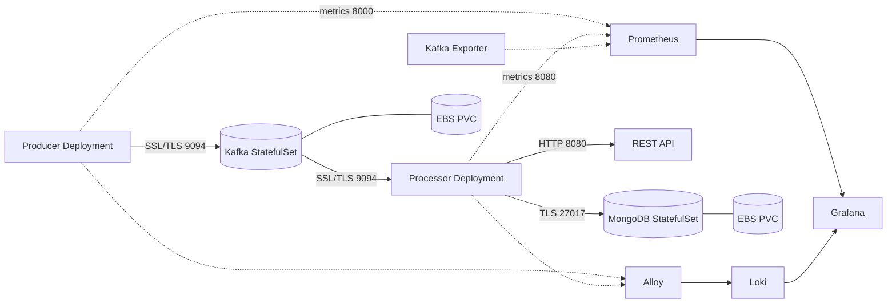

# CA3 — Cloud-Native Observability, Autoscaling, Security Hardening and Resilience

**CS5287 Cloud Computing | Amazon EKS | 8 November 2026**

> **Evidence status:** This document distinguishes observed runtime results from configuration-only inspection and automation that is still in development. See the [Integrity Packet](IntegrityPacket.md) for claim-by-claim validation.

## Contents

1. [Executive summary](#1-executive-summary)
2. [Architecture and event flow](#2-architecture-and-event-flow)
3. [Infrastructure and project layout](#3-infrastructure-and-project-layout)
4. [Observability and logging](#4-observability-and-logging)
5. [Autoscaling experiments](#5-autoscaling-experiments)
6. [Security hardening](#6-security-hardening)
7. [Resilience and recovery](#7-resilience-and-recovery)
8. [REST API and automated smoke test](#8-rest-api-and-automated-smoke-test)
9. [Operations, recreation and cost control](#9-operations-recreation-and-cost-control)
10. [Troubleshooting and engineering revisions](#10-troubleshooting-and-engineering-revisions)
11. [Evidence index](#11-evidence-index)
12. [Rubric mapping](#12-rubric-mapping)
13. [Limitations and next steps](#13-limitations-and-next-steps)

## 1. Executive summary

CA3 extends the CA0–CA2 authentication-event processing pipeline with metrics, dashboards, centralized logs, TLS, Kubernetes network isolation, CPU-driven Horizontal Pod Autoscaling (HPA), and recovery exercises. The application pipeline remains **Producer → Kafka (`auth-events`) → Processor → MongoDB**. The processor also exposes REST endpoints for health, events, alerts and metrics.

On the observed final cluster, the producer and processor Deployments and Kafka and MongoDB StatefulSets were each `1/1` ready; both HPAs were present; seven NetworkPolicies were active; the Kafka Exporter reported one broker and zero consumer-group lag. This is a single-broker/single-database-instance educational architecture, **not** a highly available production deployment.

## 2. Architecture and event flow



Events are published to Kafka, consumed and classified by the processor, and written to the MongoDB `threat_monitor.security_events` collection. Structured application logs include event IDs and Kafka offsets, allowing cross-component correlation. `POSSIBLE_BRUTE_FORCE` is an observed classification for repeated failed logins.

## 3. Infrastructure and project layout

| Item | Observed configuration |
|---|---|
| Cluster | `ca3-eks-cluster` |
| AWS region / local CLI profile | `us-east-2` / `ca2` |
| Managed node group | `ca3-workers`, three `m7i-flex.large` nodes |
| Application namespace | `ca2` |
| Monitoring namespace | `monitoring` |
| Kafka client / controller ports | `9094` TLS / `9093` |
| MongoDB port | `27017`, `requireTLS` |
| Processor REST / producer metrics | `8080` / `8000` |
| StorageClass | `ca2-gp3` |
| Consumer group | `ca0-threat-processor` |

The cluster definition is in [`eks/cluster.yaml`](eks/cluster.yaml). Key directories include `producer/`, `processor/`, `observability/`, `autoscaling/`, `security/`, `helm/`, `scripts/`, and [`evidence/`](evidence/). The Kafka and MongoDB 5 GiB claims were bound to EBS volumes. Five PVs were observed with `Retain` reclaim policies, including monitoring storage; retained EBS volumes may continue to incur charges after cluster deletion.

**Deployment dependency order for a future clean build:** AWS/EKS prerequisites and EBS CSI → namespaces and storage → TLS material and Kubernetes Secrets → ServiceAccounts/RBAC → Kafka/MongoDB Services and StatefulSets → application ConfigMaps/Deployments → monitoring releases and scrape configuration → NetworkPolicies/HPAs → automated verification. RBAC must be created **before** workloads that depend on its ServiceAccounts. The complete clean-build sequence has **not yet been validated** for CA3.

## 4. Observability and logging

The observed Helm releases were:

| Release | Chart version |
|---|---|
| `monitoring` (kube-prometheus-stack) | `92.21.1` |
| `loki` | `7.5.0` |
| `alloy` | `1.15.0` |
| `kafka-exporter` | `4.1.1` |

Prometheus collects producer, processor and Kafka Exporter metrics; Grafana displays dashboards; Alloy forwards logs to Loki. Screenshots [10](evidence/10-prometheus-targets-up.png)–[16d](evidence/16d-loki-mongodb-logs.png) document monitoring targets, dashboard evolution, centralized logs and event correlation.

### Instrumented metrics and useful queries

| Metric family | Meaning | Example PromQL |
|---|---|---|
| `events_produced_total` | Successful Kafka publications | `sum(rate(events_produced_total[5m]))` |
| `producer_errors_total` | Publishing errors | `sum(rate(producer_errors_total[5m]))` |
| `events_processed_total` | Processed events | `sum(rate(events_processed_total[5m]))` |
| `mongodb_inserts_total` | Successful MongoDB inserts | `sum(rate(mongodb_inserts_total[5m]))` |
| `processing_errors_total` | Processing errors | `sum(rate(processing_errors_total[5m]))` |
| `http_requests_total` | REST requests | `sum(rate(http_requests_total[5m]))` |
| `http_request_duration_seconds` | REST latency histogram | `histogram_quantile(0.95, sum by (le) (rate(http_request_duration_seconds_bucket[5m])))` |
| `kafka_consumergroup_lag_sum` | Consumer lag | `kafka_consumergroup_lag_sum{consumergroup="ca0-threat-processor",topic="auth-events"}` |

The final exporter check reported `kafka_brokers{cluster="ca3-eks-cluster"} 1` and `kafka_consumergroup_lag_sum{...,consumergroup="ca0-threat-processor",topic="auth-events"} 0`. A zero-lag reading is a point-in-time observation, not a guarantee of permanently zero lag.

## 5. Autoscaling experiments

Both `processor-hpa` and `producer-hpa` target **50% CPU utilization**, with **1–3 replicas**. During a two-minute producer CPU-load experiment, HPA utilization reached **251%/50%**, and the producer reached **three replicas**. After load subsided, utilization dropped to approximately **2%/50%**; HPA reduced replicas toward one and the final status showed **one**. This directly addresses CA2 feedback requesting demonstrated **automatic scale-up**, not just scale-down.

Evidence: [processor HPA scale-up](evidence/17-hpa-scale-up.png), [processor scale-down](evidence/18-hpa-scale-down.png), [producer scale-up](evidence/33-producer-hpa-scale-up.png), [producer scale-down](evidence/34-producer-hpa-scale-down.png). This CPU experiment is not a long-duration throughput benchmark.

## 6. Security hardening

**TLS:** Kafka advertises `SSL://kafka-0.kafka.ca2.svc.cluster.local:9094`, with controller traffic on 9093. MongoDB starts with `--tlsMode requireTLS` and CA/certificate files. The producer uses SSL with CA verification and hostname checking. See [Kafka TLS](evidence/28-kafka-tls-only.png), [MongoDB TLS](evidence/26-mongodb-tls-verified.png), and [MongoDB TLS enforcement](evidence/27-mongodb-requiretls-enforcement.png).

**NetworkPolicy:** Seven policies were observed: `kafka-ingress`, `kafka-tls-ingress`, `mongodb-ingress`, `processor-ingress`, `producer-metrics-ingress`, `producer-egress`, and `processor-egress`. The temporary `kafka-tls-test-ingress` policy was removed. AWS VPC CNI add-on configuration reported `enableNetworkPolicy: true` and `NETWORK_POLICY_ENFORCING_MODE: standard`.

| Connectivity test | Observed result |
|---|---|
| Producer → Kafka TCP 9094 | Allowed |
| Producer → MongoDB TCP 27017 | Timed out (consistent with deny) |
| Processor → MongoDB TCP 27017 | Allowed |

See [allow/deny evidence](evidence/35-networkpolicy-enforcement.png). These are TCP-path tests; TLS identity and certificate checks are documented separately. Standard enforcement mode can allow a brief policy-programming window for new pods.

**Secrets and Git hygiene:** Runtime credentials and TLS private files must not be committed. `.gitignore` excludes `CA3/security/tls/` and `CA3/security/backups/`, as well as common private-key extensions. The upstream Kafka Exporter Helm chart was identified as Prometheus Community chart 4.1.1, and its SASL SCRAM password field was checked as empty. A broader pre-push secrets review remains necessary. RBAC and least privilege are inherited from the CA2 design but should be rechecked on a fresh CA3 deployment rather than assumed.

## 7. Resilience and recovery

The following exercises were observed, with supporting screenshots:

| Exercise | Result and evidence |
|---|---|
| Producer Pod deletion | Deployment recreated the Pod; publishing resumed — [29](evidence/29-resilience-pod-recovery.png) |
| Processor recovery | Event processing and MongoDB writes resumed — [30](evidence/30-processor-resilience-recovery.png) |
| Kafka planned shutdown/restart | StatefulSet recovered with the same PVC; producer/processor resumed and lag returned to zero — [31](evidence/31-kafka-resilience-recovery.png) |
| MongoDB Pod deletion | StatefulSet recreated Pod; existing PVC remained bound; writes resumed — [32](evidence/32-mongodb-resilience-recovery.png) |

A Kafka EBS snapshot taken with the broker stopped completed successfully (`snap-0bc48882d896e1546`), but **restoration from the snapshot was not tested**. A TLS-authenticated MongoDB `mongodump` exported **52,565 documents**, completed with exit status 0, and passed `gzip -t`; **restoration was not tested**. Recovery observations are not evidence of multi-broker Kafka or replica-set MongoDB high availability.

### Resilience demonstration video

**[Watch the CA3 resilience drill video (YouTube, unlisted)](https://youtu.be/aF8TDq8XbP0)**

The link was supplied by the project author. Confirm it opens in a signed-out browser and meets the assignment's maximum duration before submission. The video complements screenshots 29–32; the precise video contents and duration have not been independently verified here.

## 8. REST API and automated smoke test

Source inspection confirmed four processor routes: `GET /health`, `GET /events`, `GET /alerts`, and `GET /metrics`. The health endpoint returns `status: ok`, `mongodb: connected`, and `kafka_topic: auth-events` when MongoDB responds; it returns HTTP 503 if MongoDB health checking fails. `/events` and `/alerts` return JSON arrays limited to 100 entries.

From the repository root, while the cluster is running:

```bash
bash CA3/scripts/verify-rest.sh
```

The script opens a temporary port-forward, makes actual HTTP requests, validates the health JSON, checks the events and alerts array types, verifies metric-family presence, and closes the port-forward. **Runtime result:** all four checks passed; `/events` returned 100 events and `/alerts` returned 100 alerts. [Screenshot 38](evidence/38-automated-rest-verification.png). The test does not exhaustively validate individual record contents or failure-path behavior.

## 9. Operations, recreation and cost control

**Currently tested:**

```bash
bash CA3/scripts/status.sh
bash CA3/scripts/verify-rest.sh
```

**Not yet safe for live use:** `pause.sh` and `resume.sh` exist but intentionally exit at a safety guard; they have passed `bash -n` only. **Not yet implemented/tested:** complete `create.sh` and `teardown.sh`. Do not remove guards or run destructive commands on the basis of this README.

The intended workflows are (a) **pause/resume**: preserve the cluster/PVCs while reducing node count, and (b) **full teardown/recreate**: delete the EKS infrastructure after explicit confirmation, audit retained resources, and later provision a new environment from declarative configuration. Recreating a fresh cluster **does not automatically restore Kafka or MongoDB data**. Pause mode still incurs EKS control-plane and storage costs; teardown may leave EBS volumes, snapshots, ECR storage or other billable resources. A verified create/delete round trip is outstanding.

## 10. Troubleshooting and engineering revisions

- **MongoDB backup CLI mismatch:** the installed `mongodump` accepted `--ssl` and `--sslCAFile`, not `--tls`. The command was corrected after observing an unknown-option error.
- **TLS hostname verification:** connecting to `localhost` failed because the certificate SANs covered Kubernetes DNS names, not `localhost`. The backup was retried with `mongodb.ca2.svc.cluster.local` and succeeded without disabling certificate validation.
- **Kafka snapshot consistency:** an earlier live EBS snapshot was retained as a pre-TLS recovery point, but a new snapshot was taken after stopping Kafka for a stronger recovery point. Neither was restore-tested.
- **Temporary policy cleanup:** `kafka-tls-test-ingress` was removed after the test Pod was no longer needed.
- **HPA lifecycle:** the processor HPA was restored after a Kafka drill and confirmed to calculate CPU utilization again.
- **Pause/resume safety:** early drafts were guarded with `exit 1` because syntax validation alone does not establish operational safety.
- **CA2 feedback addressed:** the producer HPA was load-tested for automatic scale-up; the REST smoke test now performs requests automatically. RBAC ordering and full recreation still require live verification.

## 11. Evidence index

All images are in [`evidence/`](evidence/). Numbering reflects the chronological evidence collection; gaps and suffixes are intentional.

| Evidence | Subject |
|---|---|
| [01–06](evidence/05-complete-pipeline-running.png) | EKS nodes, metrics server, EBS, Kafka/MongoDB, pipeline, REST |
| [07–10](evidence/10-prometheus-targets-up.png) | Instrumentation and Prometheus targets |
| [11–15](evidence/15-grafana-six-panels.png) | Grafana dashboard and Kafka lag |
| [16–16d](evidence/16-loki-centralized-logs.png) | Loki centralized logs and correlation |
| [17–19](evidence/17-hpa-scale-up.png) | Processor HPA and recovery |
| [20b–24](evidence/22-networkpolicy-allow-deny.png) | Ingress isolation and connectivity |
| [26–28](evidence/28-kafka-tls-only.png) | MongoDB and Kafka TLS |
| [29–32](evidence/31-kafka-resilience-recovery.png) | Producer, processor, Kafka and MongoDB recovery |
| [33](evidence/33-producer-hpa-scale-up.png) / [34](evidence/34-producer-hpa-scale-down.png) | Producer HPA scale-up/down |
| [35](evidence/35-networkpolicy-enforcement.png) | Egress allow/deny |
| [36](evidence/36-final-cluster-health.png) | Final cluster health |
| [37](evidence/37-automation-status.png) | `status.sh` execution |
| [38](evidence/38-automated-rest-verification.png) | Automated REST smoke test |

## 12. Rubric mapping

| Category | Weight | Supporting work |
|---|---:|---|
| Observability & Logging | 20% | Prometheus/Grafana/Loki/Alloy, screenshots 07–16d |
| Autoscaling | 15% | Two HPAs, producer automatic scale-up/down, screenshots 17–19 and 33–34 |
| Security Hardening | 15% | TLS, Secrets, ingress/egress NetworkPolicies, screenshots 20b–28 and 35 |
| Resilience | 25% | Four recovery drills, backups, video, screenshots 29–32 |
| Documentation & Usability | 10% | This README, tested status and REST scripts; remaining automation gaps disclosed |
| Integrity Packet | 15% | [Claim/evidence/verification record](IntegrityPacket.md) |

## 13. Limitations and next steps

1. Kafka has one broker and MongoDB one instance; neither is a high-availability configuration.
2. Kafka EBS and MongoDB archive restoration have not been tested.
3. EKS standard NetworkPolicy mode can have a startup enforcement window.
4. HPA CPU-load results do not establish sustained throughput or production capacity.
5. Complete fresh provisioning, pause/resume, and full teardown automation remain unfinished or untested.
6. TLS credential rotation, secret-management lifecycle and monitoring persistence recovery require additional work.
7. CA3 is AWS-specific; CA4's multi-cloud architecture should avoid treating EKS/EBS as provider-neutral primitives.

**Final observation:** The running CA3 pipeline demonstrated monitoring, TLS-protected communication, automatic scaling, network isolation and recovery from individual workload disruptions. The [Integrity Packet](IntegrityPacket.md) records precisely what supports each claim.


## Automation review update (2026-11-08)

The reviewed scripts `pause.sh`, `resume.sh`, and `teardown.sh` have passed local Bash syntax checks only; **they have not been executed against the live EKS cluster**. `create.sh` intentionally exits during preflight because this archive does not contain a reproducible TLS/Secrets, EBS CSI, RBAC, Services, and ECR bootstrap. It does not provision infrastructure. The teardown script deletes the EKS cluster only after explicit confirmation, retains EBS volumes and snapshots for manual ownership review, and cannot guarantee zero AWS charges. Do not claim a successful delete/recreate round trip. Pause/resume assumes one replica per application workload and depends on the local Kafka Exporter port-forward; monitoring is not deliberately scaled down. Pause/resume is not a validated production procedure.
